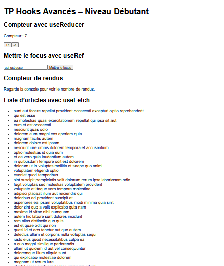
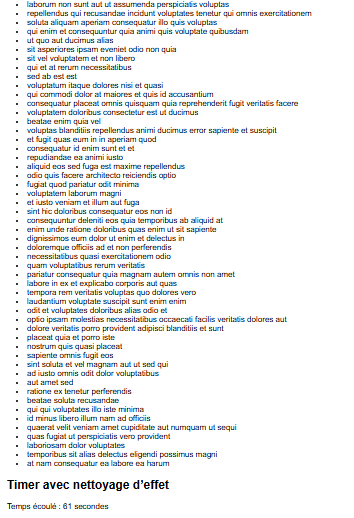

# TP 6 : Découverte des Hooks Avancés et des Hooks Personnalisés

Application React réalisée dans le cadre du sixième TP. Elle présente sur une seule page plusieurs hooks avancés de React ainsi qu'un hook personnalisé pour récupérer des données depuis une API.

## Ce que le projet démontre

- la gestion d'un état avec `useReducer`, un reducer et des actions
- l'accès direct à un élément du DOM avec `useRef`
- l'utilisation de `useRef` pour garder une valeur entre deux rendus sans en provoquer un nouveau
- la création d'un hook personnalisé, `useFetch`
- un effet avec nettoyage grâce à `useEffect` et `clearInterval`

## Prérequis

- Node.js (version LTS, 16 ou plus)
- npm
- une connexion internet, nécessaire pour charger la liste d'articles
- un éditeur de code, par exemple Visual Studio Code

Pour vérifier l'installation :

```bash
node -v
npm -v
```

## Installation et lancement

Depuis le dossier du projet :

```bash
npm install
npm start
```

L'application s'ouvre sur `http://localhost:3000`. Si ce n'est pas le cas, il suffit de taper l'adresse dans le navigateur. Pour arrêter le serveur, utiliser `Ctrl + C` dans le terminal.

### Problème fréquent sous Windows

Si PowerShell indique que l'exécution de scripts est désactivée :

```powershell
Set-ExecutionPolicy -Scope CurrentUser -ExecutionPolicy RemoteSigned
```

Autre possibilité : utiliser `npm.cmd` à la place de `npm` (par exemple `npm.cmd start`).

## Structure du projet

```
src/
├── App.js
├── Compteur.js
├── FocusInput.js
├── CompteurRendu.js
├── ListeArticles.js
├── Timer.js
├── useFetch.js
├── index.js
└── index.css
```

## Les composants

| Fichier | Rôle |
|---|---|
| `Compteur` | Compteur géré avec `useReducer`, avec les actions `increment` et `decrement` |
| `FocusInput` | Un bouton place le curseur dans le champ de texte grâce à `useRef` |
| `CompteurRendu` | Compte le nombre d'affichages du composant et l'écrit dans la console |
| `useFetch` | Hook personnalisé qui télécharge des données et retourne `data`, `chargement` et `erreur` |
| `ListeArticles` | Utilise `useFetch` pour afficher la liste des articles de l'API JSONPlaceholder |
| `Timer` | Compte les secondes avec `setInterval`, arrêté proprement au démontage du composant |

`App.js` assemble tous les composants dans des sections distinctes.

## Exécution

### Haut de la page

Le compteur à 7, le champ de texte avec le bouton de focus, le message du compteur de rendus et le début de la liste d'articles.



### Bas de la page

La fin de la liste d'articles chargée avec `useFetch`, puis le timer qui affiche le temps écoulé.



